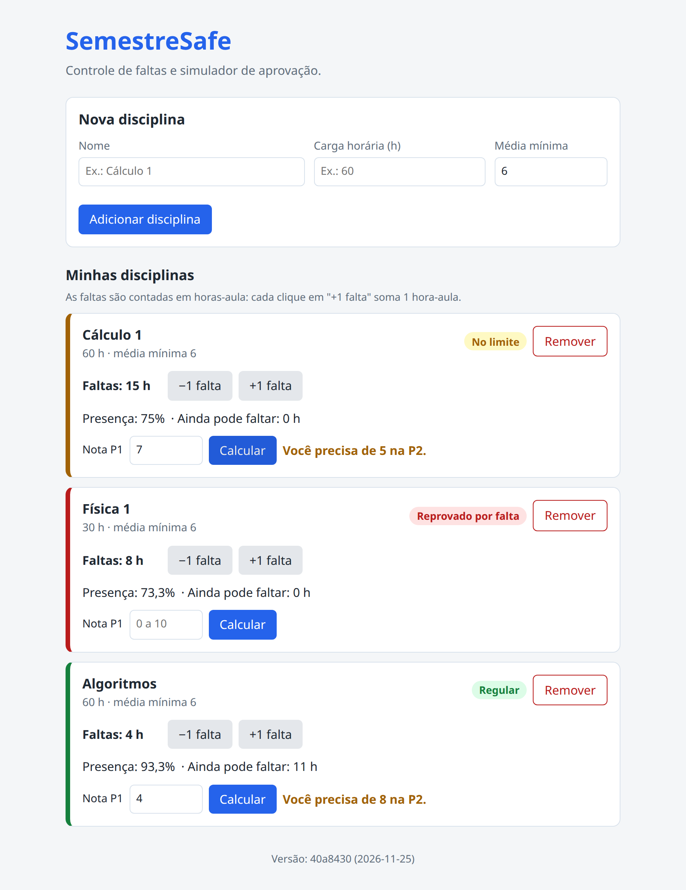
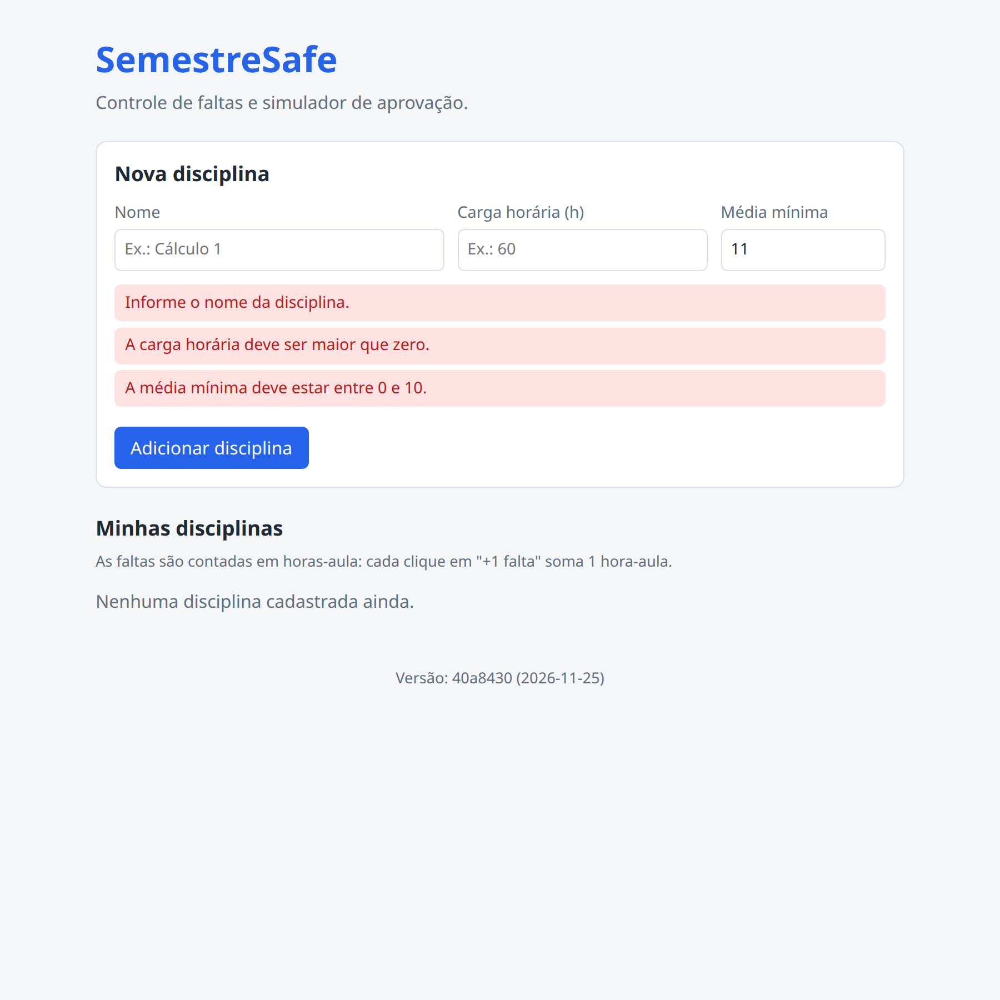
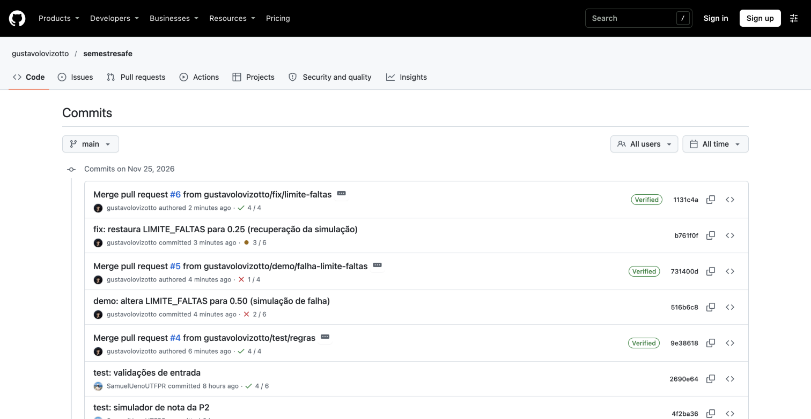
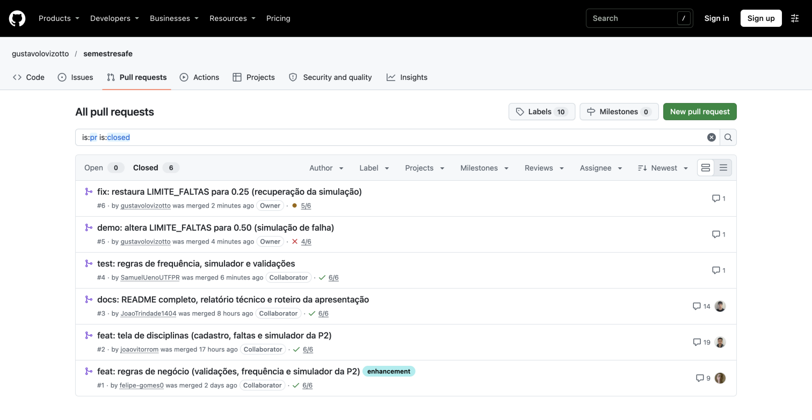
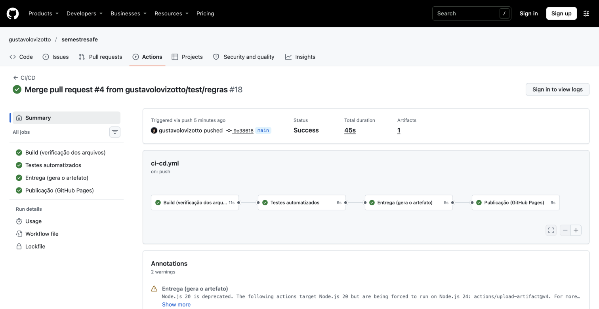
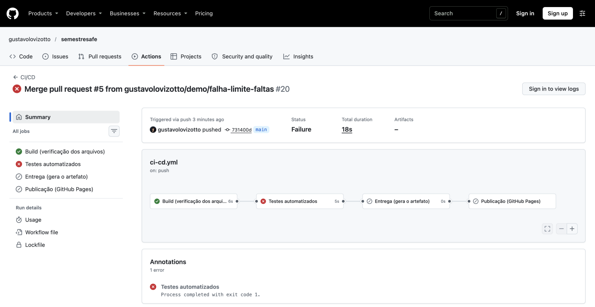
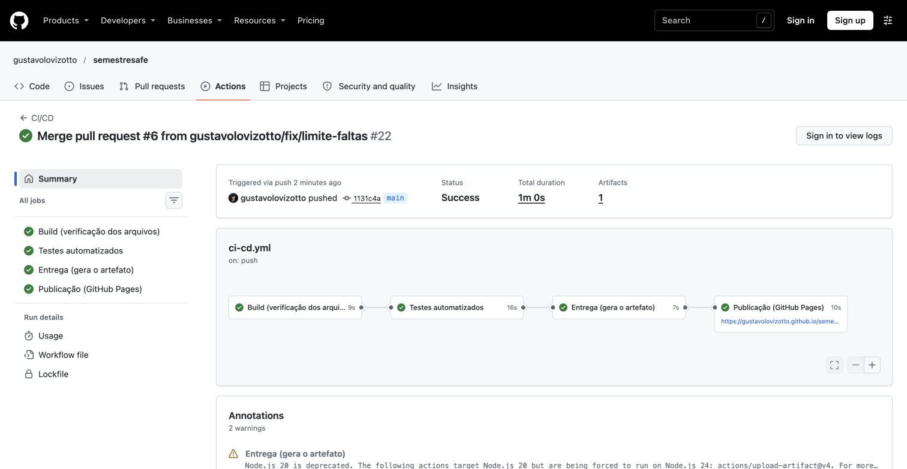
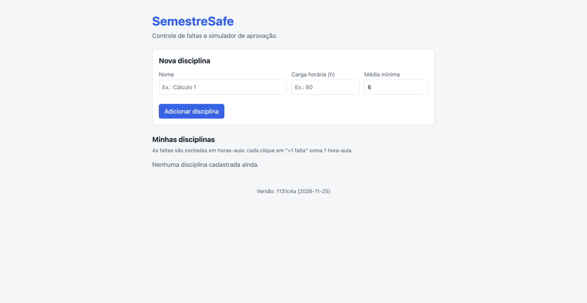

# Relatório Técnico — Operação Deploy: SemestreSafe

> **Nota de preenchimento (remover antes de exportar o PDF final):** Este arquivo é o rascunho base do relatório que será exportado para PDF. As partes dependentes dos demais integrantes ou de execuções finais do pipeline estão marcadas com `[PENDENTE – responsável]`. Antes de gerar o PDF final, remover também: o bloco *"Referência do código..."* na Seção 3, a *"Observação sobre o estado atual na `main`"* na Seção 7 e o *"Roteiro rápido de perguntas"* na Seção 11.

## Sumário

1. [Identificação](#1-identificação)
2. [Introdução e contextualização](#2-introdução-e-contextualização)
3. [Escopo e funcionalidades](#3-escopo-e-funcionalidades)
4. [Tecnologias e ambiente](#4-tecnologias-e-ambiente)
5. [Organização do trabalho e gerência de configuração](#5-organização-do-trabalho-e-gerência-de-configuração)
6. [Pipeline de CI](#6-pipeline-de-ci)
7. [Plano e execução dos testes](#7-plano-e-execução-dos-testes)
8. [Entrega contínua, artefato e publicação](#8-entrega-contínua-artefato-e-publicação)
9. [Simulação de falha, bloqueio e recuperação](#9-simulação-de-falha-bloqueio-e-recuperação)
10. [Resultado final e rastreabilidade](#10-resultado-final-e-rastreabilidade)
11. [Dificuldades, decisões e aprendizados](#11-dificuldades-decisões-e-aprendizados)
12. [Considerações finais](#12-considerações-finais)
13. [Referências e Declaração de Uso de Ferramentas de IA](#13-referências-e-declaração-de-uso-de-ferramentas-de-ia)

---

## Lista de Figuras

- **Figura 1** – Interface do SemestreSafe em funcionamento, exibindo cadastro de disciplinas, controle de faltas e simulador da P2. *(Seção 3)*
- **Figura 2** – Histórico de commits, branches e Pull Requests no repositório do GitHub. *(Seção 5)*
- **Figura 3** – Execução do pipeline de CI/CD concluída com sucesso (todos os jobs verdes na branch `main`). *(Seção 6)*
- **Figura 4** – Pipeline reprovado na etapa de testes automatizados durante a simulação de falha (`LIMITE_FALTAS` alterado para `0.50`). *(Seção 9)*
- **Figura 5** – Bloqueio automático do deploy: jobs de Entrega e Publicação marcados como *skipped* após falha nos testes. *(Seção 9; mesma captura da Figura 4)*
- **Figura 6** – Recuperação do pipeline com todos os jobs verdes após a correção da constante `LIMITE_FALTAS` para `0.25`. *(Seção 9)*
- **Figura 7** – Aplicação SemestreSafe acessível no GitHub Pages exibindo o hash do commit publicado no rodapé (rastreabilidade). *(Seção 10)*

---

## 1. Identificação

- **Instituição:** Universidade Tecnológica Federal do Paraná (UTFPR) – Câmpus Cornélio Procópio
- **Disciplina:** ES46B – Gerência de Configuração e Manutenção de Software
- **Turma:** ES61
- **Professora:** Eduarda Maganha de Almeida
- **Projeto:** Operação Deploy
- **Aplicação:** SemestreSafe — Controle de faltas e simulador de aprovação universitária
- **Repositório:** https://github.com/gustavolovizotto/semestresafe
- **Aplicação publicada:** https://gustavolovizotto.github.io/semestresafe/
- **Data de entrega:** 25/11/2026

### Equipe e divisão de responsabilidades

O grupo atuou de forma integrada: antes de iniciar o desenvolvimento paralelo, todos alinharam o contrato das funções de negócio em `src/js/regras.js` e o fluxo de branches/Pull Requests. Cada integrante assumiu uma frente principal, mas as entregas passaram por revisão cruzada via Pull Request para garantir coerência entre código, testes, pipeline e documentação.

| Integrante | Papel principal | Principais entregas e participação |
|---|---|---|
| Gustavo Tesin | Repositório, CI/CD e simulação de falha | Estrutura inicial, proteção da `main`, workflow `.github/workflows/ci-cd.yml`, publicação no GitHub Pages, execução da simulação de falha e revisão de PRs |
| João Vitor Romani | Interface do usuário | Desenvolvimento da tela em `src/index.html`, `src/css/style.css` e `src/js/app.js`, integração com `regras.js` e `localStorage`, revisão de PRs |
| Felipe Gomes | Regras de negócio | Implementação das validações, cálculo de frequência e simulador da P2 em `src/js/regras.js`, documentação do escopo e revisão de PRs |
| Samuel Ueno | Testes automatizados | Plano e implementação dos testes unitários em `tests/`, validação da falha controlada e revisão de PRs |
| João Vitor Trindade | Documentação e organização da entrega | Elaboração do `README.md`, consolidação deste relatório técnico, roteiro dos slides, checagem final de links/evidências e envio no Moodle |

---

## 2. Introdução e contextualização

Ao longo de um semestre letivo na graduação, o estudante geralmente cursa diversas disciplinas simultaneamente, cada uma com carga horária distinta e critérios próprios de avaliação. Um problema recorrente nesse cenário é perder o controle do limite máximo de faltas permitido — normalmente 25% da carga horária total da disciplina —, descobrindo tarde demais que está no limite ou reprovado por frequência. Além disso, após realizar a primeira avaliação (P1), o aluno frequentemente precisa calcular manualmente qual nota mínima precisa alcançar na segunda avaliação (P2) para ser aprovado.

O público-alvo do **SemestreSafe** são estudantes universitários que buscam uma ferramenta rápida, acessível pelo navegador e sem burocracia (sem necessidade de criar conta ou instalar aplicativos) para acompanhar sua situação acadêmica básica ao longo do semestre.

A motivação do projeto une esse problema prático do cotidiano estudantil com o objetivo central da disciplina ES46B: vivenciar um processo disciplinado de Gerência de Configuração de Software e Entrega/Publicação Contínua. Em vez de construir um sistema complexo com muitas telas, a equipe optou por uma aplicação enxuta e bem definida para concentrar esforços na qualidade do processo — controle de versão com branches e Pull Requests, testes automatizados e um pipeline de CI/CD capaz de barrar automaticamente a publicação quando um defeito é introduzido.

Dessa forma, o objetivo geral deste trabalho é desenvolver, testar e publicar o SemestreSafe no GitHub Pages por meio de um pipeline automatizado no GitHub Actions, comprovando com evidências reais tanto o funcionamento da aplicação quanto o bloqueio e a recuperação do deploy diante de falhas.

---

## 3. Escopo e funcionalidades

`[PENDENTE – Felipe Gomes: descrever o escopo do sistema, detalhando cada funcionalidade implementada (cadastro e remoção de disciplinas, registro de faltas, cálculo do percentual de presença/faltas restantes/status com limite de 25%, e simulação de nota necessária na P2 com indicação de "Aprovado", nota necessária ou "Reprovado"), além do que foi deixado fora de escopo.]`

> **Referência do código já presente na `main` (`src/js/regras.js`) para apoiar o preenchimento do Felipe Gomes:**
> - Constante `LIMITE_FALTAS = 0.25`.
> - `validarNota(n)`: verifica número entre 0 e 10.
> - `validarFaltas(faltas, cargaHoraria)`: verifica inteiro entre `0` e `cargaHoraria`.
> - `validarDisciplina({ nome, cargaHoraria, mediaMinima })`: retorna lista de erros para campos inválidos.
> - `calcularFrequencia(cargaHoraria, faltas)`: calcula `maxFaltas = Math.floor(cargaHoraria * LIMITE_FALTAS)`, `percentualPresenca` (1 casa decimal), `faltasRestantes` e `status` (`"Regular"`, `"No limite"` ou `"Reprovado por falta"`).
> - `calcularNotaNecessaria(mediaMinima, p1)`: calcula `2 * mediaMinima - p1` (1 casa decimal), retornando `"Aprovado"` se `<= 0`, `"Reprovado"` se `> 10`, ou a nota necessária.

### Evidências da aplicação em funcionamento



*Figura 1a – Interface do SemestreSafe publicada no GitHub Pages (versão `40a8430` no rodapé), com três disciplinas cadastradas, uma em cada status de frequência (Regular em verde, No limite em amarelo e Reprovado por falta em vermelho), e o simulador da P2: com média 6, uma P1 de 7 exige 5 na P2 e uma P1 de 4 exige 8.*



*Figura 1b – Cadastro recusado: com nome vazio, carga horária em branco e média 11, a tela exibe as três mensagens devolvidas por `validarDisciplina` e não salva a disciplina.*

---

## 4. Tecnologias e ambiente

A equipe escolheu uma pilha simples, sem frameworks nem dependências de terceiros, para reduzir falhas de ambiente e manter o pipeline leve e fácil de inspecionar.

| Tecnologia / Ferramenta | Finalidade no projeto |
|---|---|
| **HTML5** (`src/index.html`) | Estrutura semântica da aplicação web e marcação do rodapé de versão |
| **CSS3** (`src/css/style.css`) | Estilização e layout responsivo da interface |
| **JavaScript (ES Modules)** (`src/js/app.js`, `src/js/regras.js`) | Lógica da interface e regras de negócio puras, configuradas com `"type": "module"` no `package.json` |
| **Web Storage (`localStorage`)** | Armazenamento local das disciplinas no navegador do usuário (chave `semestresafe:disciplinas`) |
| **Node.js** (18+ local / 22 no CI) | Runtime utilizado para validação de sintaxe (`node --check`), execução dos testes e servidor local |
| **`node:test` e `node:assert/strict`** (`tests/`) | Execução dos testes automatizados usando o runner nativo do Node.js, sem instalar bibliotecas externas |
| **`npx serve`** (`npm start`) | Servidor HTTP estático local para servir a pasta `src/` durante o desenvolvimento |
| **Git e GitHub** | Controle de versão, fluxo baseado em branches, revisão por Pull Request e proteção da branch `main` |
| **GitHub Actions** (`.github/workflows/ci-cd.yml`) | Automação das etapas de build, testes, empacotamento do artefato e deploy |
| **GitHub Pages** | Hospedagem pública e gratuita da versão estática gerada pelo pipeline |

### Execução do ambiente local

Para rodar o projeto localmente é necessário ter o **Git** e o **Node.js (versão 18 ou superior)** instalados:

```bash
# Clonar o repositório
git clone https://github.com/gustavolovizotto/semestresafe.git
cd semestresafe

# Executar os testes automatizados
npm test

# Subir a aplicação localmente em http://localhost:3000
npm start
```

O arquivo `package.json` define apenas dois scripts, sem necessidade de rodar `npm install` previamente (`node_modules` local):
- `"test": "node --test"` — executa os testes localmente usando apenas módulos nativos do Node.js (funciona totalmente offline).
- `"start": "npx serve src"` — sobe o servidor estático local; na primeira execução, o `npx` baixa sob demanda o pacote `serve` do registro do npm (exige conexão com a internet e pode solicitar confirmação no terminal).

---

## 5. Organização do trabalho e gerência de configuração

### Estrutura do repositório

O repositório foi organizado de forma a separar claramente o código-fonte da aplicação, os testes automatizados, a documentação e a automação de CI/CD:

```text
semestresafe/
├── .github/
│   └── workflows/
│       └── ci-cd.yml          # Definição do pipeline de CI/CD
├── docs/
│   ├── evidencias/            # Espaço reservado para evidências do projeto
│   ├── apresentacao.md        # Roteiro dos slides da apresentação
│   └── relatorio.md           # Rascunho do relatório técnico
├── src/
│   ├── css/
│   │   └── style.css          # Estilos da interface
│   ├── js/
│   │   ├── app.js             # Controle da tela, localStorage e leitura de versao.txt
│   │   └── regras.js          # Regras de negócio puras (contrato do grupo)
│   └── index.html             # Página principal da aplicação
├── tests/
│   ├── contrato.test.js       # Verifica se regras.js exporta o contrato esperado
│   └── ...                    # Testes de comportamento das regras (Samuel Ueno)
├── .gitignore                 # Ignora node_modules/, dist/ e .DS_Store
├── package.json               # Metadados do projeto e scripts npm
└── README.md                  # Documentação principal do repositório
```

O `.gitignore` garante que arquivos temporários e artefatos gerados em build (`dist/` e `node_modules/`) não sejam versionados manualmente no Git.

### Padrão de commits

Os commits seguem mensagens curtas em português com prefixos semânticos indicando o tipo de alteração:

- `chore:` configurações e estrutura inicial (ex.: `chore: estrutura inicial e configuração do projeto`)
- `feat:` novas funcionalidades (ex.: `feat: esqueleto da aplicação e contrato das regras de negócio`, `feat: cálculo de frequência`)
- `fix:` correções de bugs ou configurações (ex.: `fix(ci): corrige YAML da verificação de sintaxe`, `fix: valida entradas do cálculo de frequência`)
- `test:` criação ou ajuste de testes automatizados
- `docs:` documentação (ex.: `docs: README completo`, `docs: rascunho do relatório técnico`)
- `ci:` ajustes no pipeline (ex.: `ci: atualiza checkout e setup-node para v5 (Node 20 descontinuado)`)
- `style:` ajustes visuais/CSS sem mudança de lógica

### Estratégia de branches, Pull Requests e proteção da `main`

Para evitar conflitos e garantir que nenhum código chegue à versão principal sem validação, o grupo adotou o modelo de **branches por tarefa** criadas a partir da `main`:

- `feat/disciplinas` — desenvolvimento da interface e interação com o usuário (João Vitor Romani — PR `#2`, já integrado na `main`);
- `feat/regras` — implementação das regras de negócio (Felipe Gomes — PR `#1`, já integrado na `main`);
- `test/regras` — testes unitários das regras de negócio (Samuel Ueno — PR `#4`, integrado na `main`);
- `docs/readme` — atualização do `README.md`, relatório técnico e roteiro da apresentação (João Vitor Trindade — PR `#3`, integrado na `main`);
- `demo/falha-limite-faltas` e `fix/limite-faltas` — simulação de falha e recuperação (Gustavo Tesin — PRs `#5` e `#6`, ver Seção 9).

Os primeiros commits do repositório (`e853114` a `9a63bd0`, referentes à estrutura inicial, ao contrato base e aos ajustes iniciais do workflow) foram realizados diretamente na `main` durante a configuração inicial do ambiente. Concluída essa preparação, a branch `main` foi configurada como **protegida** no GitHub, bloqueando pushes diretos. A partir daí, todas as tarefas do grupo seguiram o fluxo:
1. Criar branch específica a partir da `main` atualizada;
2. Realizar commits pequenos e descritivos;
3. Abrir um Pull Request (PR) para a `main`;
4. Aguardar a execução do CI (`Build` e `Testes`) no PR e a revisão de outro integrante antes de realizar o merge.

A proteção da `main` exige Pull Request, mas não exige que os checks estejam verdes para o merge. Quem garante que uma versão reprovada não chega ao ar é o próprio pipeline: na `main`, a Entrega e a Publicação só rodam se o Build e os Testes passarem (ver Seções 6 e 9).

### Evidências do controle de versão



*Figura 2a – Histórico de commits da `main`: cada tarefa entra por um merge de Pull Request (`Merge pull request #N`), com o status do pipeline de cada commit ao lado (✓ verde, ✗ vermelho). Os commits `516b6c8`/`731400d` (falha provocada) e `b761f0f`/`1131c4a` (correção) são os da Seção 9.*



*Figura 2b – Os seis Pull Requests do projeto, um por branch de tarefa, com autor e resultado dos checks. O PR #5 aparece com checks reprovados (simulação de falha) e o PR #6 com a correção.*

---

## 6. Pipeline de CI

O pipeline do projeto está definido em `.github/workflows/ci-cd.yml` e divide o processo em duas etapas de Integração Contínua (`build` e `test`) seguidas por duas etapas de Entrega/Publicação Contínua (`entrega` e `publicacao`).

### Gatilhos e permissões

```yaml
name: CI/CD

on:
  push:
    branches: [main]
  pull_request:
    branches: [main]
  workflow_dispatch:

permissions:
  contents: read
```

- **`push` na `main`:** dispara o pipeline completo (CI + CD) sempre que um PR é mesclado na branch principal.
- **`pull_request` na `main`:** dispara apenas a parte de CI (`build` e `test`) para validar o código antes do merge.
- **`workflow_dispatch`:** permite disparar o workflow manualmente pela interface do GitHub Actions quando necessário.
- **`permissions: contents: read`:** define permissão mínima de leitura no nível global do workflow; permissões extras de publicação (`pages: write` e `id-token: write`) ficam restritas apenas ao job `publicacao`.

### Job `build` — Verificação de arquivos e sintaxe

```yaml
  build:
    name: Build (verificação dos arquivos)
    runs-on: ubuntu-latest
    steps:
      - uses: actions/checkout@v5
      - uses: actions/setup-node@v5
        with:
          node-version: 22
      - name: Verificar arquivos obrigatórios
        run: |
          for f in src/index.html src/css/style.css src/js/app.js src/js/regras.js package.json; do
            test -f "$f" || { echo "::error::Arquivo obrigatório ausente: $f"; exit 1; }
            echo "ok: $f"
          done
      - name: Verificar sintaxe do JavaScript
        run: |
          for f in src/js/*.js tests/*.js; do
            node --check "$f" && echo "ok: $f"
          done
```

Como a aplicação usa HTML, CSS e JavaScript puro (sem etapa de compilação ou transpilação), o job `build` atua como validação estrutural e sintática:
1. Faz checkout do repositório (`actions/checkout@v5`) e configura o Node.js 22 (`actions/setup-node@v5`).
2. Verifica com `test -f` se os cinco arquivos essenciais (`src/index.html`, `src/css/style.css`, `src/js/app.js`, `src/js/regras.js` e `package.json`) existem. Caso algum esteja ausente, encerra o job com erro (`exit 1`).
3. Roda `node --check` sobre os arquivos `.js` de `src/js/` e `tests/`. *(Observação técnica: na escrita atual `node --check "$f" && echo "ok: $f"` dentro do laço `for`, o `bash -e` considera apenas o código de saída da última iteração do loop; caso haja erro de sintaxe em um dos primeiros arquivos e o último esteja válido, o bloqueio efetivo ocorre logo em seguida no job `test` ao importar os módulos, ou pode ser antecipado trocando o trecho por `node --check "$f" || exit 1`.)*

### Job `test` — Testes automatizados

```yaml
  test:
    name: Testes automatizados
    needs: build
    runs-on: ubuntu-latest
    steps:
      - uses: actions/checkout@v5
      - uses: actions/setup-node@v5
        with:
          node-version: 22
      - name: Rodar testes
        run: npm test
```

O job `test` usa a cláusula **`needs: build`**, o que estabelece dependência direta: os testes só começam se o `build` tiver sido aprovado. Nele, o runner executa `npm test` (`node --test`), encerrando com código de erro caso qualquer caso de teste falhe.

### Papel de `needs` e `if` no controle do fluxo

Dois mecanismos do YAML garantem a segurança do pipeline:
- **`needs`:** encadeia os jobs na ordem `build` → `test` → `entrega` → `publicacao` (`needs: [build, test]` na entrega e `needs: entrega` na publicação). Por padrão no GitHub Actions, se qualquer job listado em `needs` falhar, os jobs dependentes não são executados e aparecem como *skipped*.
- **`if: github.event_name != 'pull_request'`:** aplicada no job `entrega`, essa condição garante que Pull Requests executem apenas as checagens de CI (`build` e `test`), sem gerar artefato nem sobrescrever a versão em produção. Eventos fora de PR (`push` na `main` ou disparo manual via `workflow_dispatch`) passam por essa condição; no caso de um `workflow_dispatch` acionado em outra branch, a proteção contra deploy indevido no GitHub Pages fica a cargo da restrição de branch configurada no ambiente `github-pages` (restrito à `main`).

### Evidência do pipeline em execução com sucesso



*Figura 3 – Execução [#18](https://github.com/gustavolovizotto/semestresafe/actions/runs/45696220376) do workflow `ci-cd.yml`, disparada pelo push na `main` do merge do PR #4 (commit `9e38618`): Build, Testes, Entrega e Publicação concluídos com sucesso, com o artefato `github-pages` gerado.*

---

## 7. Plano e execução dos testes

`[PENDENTE – Samuel Ueno: apresentar o plano de testes e os casos implementados em tests/regras.test.js (cenários válidos, limites de borda como exatamente 25% de faltas, faltas acima do limite, nota 0 e 10, aprovação direta, reprovação impossível de reverter na P2 e entradas inválidas que disparam exceção), explicar como os testes são executados com npm test e incluir o print/saída real dos testes passando localmente e no GitHub Actions.]`

> **Observação sobre o estado atual na `main`:** já existe no repositório o arquivo `tests/contrato.test.js`, que verifica automaticamente se `src/js/regras.js` exporta as funções combinadas no contrato do grupo (`validarNota`, `validarFaltas`, `validarDisciplina`, `calcularFrequencia`, `calcularNotaNecessaria`) e a constante `LIMITE_FALTAS` como número. Os testes detalhados de comportamento serão descritos pelo Samuel Ueno após o merge da branch `test/regras`.

---

## 8. Entrega contínua, artefato e publicação

Quando uma alteração é integrada na `main` e passa pelas etapas `build` e `test`, o pipeline executa os jobs `entrega` e `publicacao`.

### Geração do artefato (`entrega`)

```yaml
  entrega:
    name: Entrega (gera o artefato)
    needs: [build, test]
    if: github.event_name != 'pull_request'
    runs-on: ubuntu-latest
    steps:
      - uses: actions/checkout@v5
      - name: Montar versão validada
        run: |
          cp -r src dist
          echo "${GITHUB_SHA::7} ($(date -u +%Y-%m-%d))" > dist/versao.txt
          cat dist/versao.txt
      - uses: actions/upload-pages-artifact@v3
        with:
          path: dist
```

Nessa etapa, o pipeline monta uma versão validada da aplicação em um diretório separado (`dist/`):
1. Copia todo o conteúdo de `src/` para `dist/`.
2. Gera o arquivo `dist/versao.txt` com os 7 primeiros caracteres do hash do commit (`${GITHUB_SHA::7}`) e a data em UTC no formato `AAAA-MM-DD`.
3. Publica a pasta `dist/` como artefato do GitHub Pages por meio da action `actions/upload-pages-artifact@v3`.

### Publicação no GitHub Pages (`publicacao`)

```yaml
  publicacao:
    name: Publicação (GitHub Pages)
    needs: entrega
    runs-on: ubuntu-latest
    permissions:
      pages: write
      id-token: write
    environment:
      name: github-pages
      url: ${{ steps.deploy.outputs.page_url }}
    steps:
      - id: deploy
        uses: actions/deploy-pages@v4
```

O job `publicacao` depende de `entrega` (`needs: entrega`), solicita apenas as permissões necessárias para o Pages (`pages: write` e `id-token: write`) e utiliza `actions/deploy-pages@v4` para disponibilizar o artefato na URL pública do projeto.

### Como verificar o acesso

Após o término do job `publicacao`, a verificação do deploy é feita de duas formas:
1. Acessar https://gustavolovizotto.github.io/semestresafe/ (de preferência em uma aba anônima para descartar cache local) e conferir se a aplicação carrega e responde normalmente.
2. Conferir no rodapé da página o texto exibido ao lado de `Versão:` — preenchido pelo `fetch('versao.txt')` em `src/js/app.js` — ou abrir diretamente https://gustavolovizotto.github.io/semestresafe/versao.txt para confirmar o hash curto do commit e a data.

### Continuous Delivery vs. Continuous Deployment

Embora os dois termos usem a mesma sigla (CD), eles representam níveis diferentes de automação:

- **Continuous Delivery (Entrega Contínua):** toda alteração aprovada no CI gera automaticamente um artefato testado e pronto para produção, mas a decisão e o disparo final do deploy ficam sob controle humano (aprovação manual).
- **Continuous Deployment (Implantação/Publicação Contínua):** além de validar e empacotar o artefato, o pipeline publica automaticamente a nova versão em produção assim que todos os testes passam, sem nenhum passo manual após o merge na branch principal.

**Qual o SemestreSafe utiliza e por quê:** o projeto pratica **Continuous Deployment** a partir da branch `main`. Uma vez que um Pull Request é revisado e mesclado na `main`, o pipeline executa `build`, `test`, gera o artefato em `entrega` e realiza o deploy diretamente no GitHub Pages no job `publicacao`, sem etapa manual de aprovação de release. (O controle humano existe antes, na revisão e aprovação do Pull Request; depois que o código entra na `main`, a publicação é totalmente automática — desde que os testes passem.)

---

## 9. Simulação de falha, bloqueio e recuperação

Para demonstrar na prática que o pipeline protege o ambiente publicado, foi planejado um teste controlado de falha, bloqueio e recuperação **após a integração da suíte de comportamento (`test/regras`) na `main`** — já que `tests/contrato.test.js` valida apenas os tipos exportados (`typeof === 'number'`), enquanto `tests/regras.test.js` verifica os resultados reais do limite de 25% (por exemplo, para carga horária `60` e `15` faltas, `calcularFrequencia(60, 15).status` deve retornar `'No limite'`, mas retornaria `'Regular'` com limite de 50%):

1. **Introdução da falha:** alterar a constante `LIMITE_FALTAS` em `src/js/regras.js` de `0.25` (25%) para `0.50` (50%) em uma branch de simulação, violando diretamente a regra de negócio de frequência da aplicação.
2. **Execução e bloqueio automático:** a alteração foi feita na branch `demo/falha-limite-faltas` e entrou na `main` pelo PR `#5`, como qualquer outra mudança do grupo. No próprio PR o check `Testes automatizados` já ficou vermelho (em PR, a Entrega e a Publicação não rodam por causa do `if: github.event_name != 'pull_request'`). O merge foi feito mesmo assim, de propósito: a proteção da `main` exige PR, mas não exige checks verdes, e o objetivo era mostrar o pipeline barrando a publicação no fluxo real da `main`. No push do merge, o job `build` passou, o job `test` falhou nos testes de frequência e os jobs `entrega` e `publicacao` ficaram **skipped** por causa do `needs: [build, test]`. A versão publicada continuou a anterior.
3. **Correção e recuperação:** a constante voltou para `0.25` na branch `fix/limite-faltas` (PR `#6`). O check do PR passou e, no push do merge na `main`, o pipeline concluiu `build`, `test`, `entrega` e `publicacao` em verde, publicando a versão corrigida.

### Evidências da simulação

| Etapa | Commit na `main` | Execução do pipeline | Resultado | Versão no ar (`versao.txt`) |
|---|---|---|---|---|
| Antes da simulação (merge do PR #4) | [`9e38618`](https://github.com/gustavolovizotto/semestresafe/commit/9e38618f2dfd99333319378c7f55b0220c1cca54) | [#18](https://github.com/gustavolovizotto/semestresafe/actions/runs/45696220376) | 4 jobs verdes | `9e38618 (2026-11-25)` |
| Falha provocada (merge do PR #5, `LIMITE_FALTAS = 0.50`) | [`731400d`](https://github.com/gustavolovizotto/semestresafe/commit/731400d0fe5dd1e7441fc26f7b8b3d06bf3909c2) | [#20](https://github.com/gustavolovizotto/semestresafe/actions/runs/45696535495) | Build ✓, Testes ✗, Entrega e Publicação *skipped* | continuou `9e38618 (2026-11-25)` |
| Correção (merge do PR #6, `LIMITE_FALTAS = 0.25`) | [`1131c4a`](https://github.com/gustavolovizotto/semestresafe/commit/1131c4ab5986d36876d7a1d0df62872e4201bbf4) | [#22](https://github.com/gustavolovizotto/semestresafe/actions/runs/45696832345) | 4 jobs verdes | `1131c4a (2026-11-25)` |

Saída do job `Testes automatizados` na execução #20 (trecho do log do GitHub Actions):

```text
not ok 1 - reprova por falta quando passa de 25% (60h, 16 faltas)
  expected: 'Reprovado por falta'
  actual: 'Regular'
not ok 2 - fica no limite de 25% sem faltas restantes (60h, 15 faltas)
  expected: 'No limite'
  actual: 'Regular'
not ok 3 - mantém frequência regular, 5 faltas restantes e 83.3% de presença (60h, 10 faltas)
# pass 22
# fail 3
##[error]Process completed with exit code 1.
```

Com o limite em 50%, um aluno com 16 faltas em 60 h (26,7%) aparecia como "Regular" em vez de "Reprovado por falta". Os três testes de frequência pegaram o erro, e os outros 22 continuaram passando.



*Figuras 4 e 5 – Execução #20 na `main` (commit `731400d`, `LIMITE_FALTAS = 0.50`): o job Testes automatizados falhou ("Process completed with exit code 1") e os jobs Entrega e Publicação ficaram skipped. O site seguiu exibindo a versão `9e38618`.*



*Figura 6 – Execução #22 na `main` (commit `1131c4a`, `LIMITE_FALTAS = 0.25`): os quatro jobs verdes e a URL do GitHub Pages publicada pelo job Publicação.*

---

## 10. Resultado final e rastreabilidade

### Links do projeto

- **Repositório no GitHub:** https://github.com/gustavolovizotto/semestresafe
- **Aplicação publicada (GitHub Pages):** https://gustavolovizotto.github.io/semestresafe/
- **Arquivo de versão publicado:** https://gustavolovizotto.github.io/semestresafe/versao.txt

### Mecanismo de rastreabilidade

A rastreabilidade ponta a ponta entre o que está no ar e o código-fonte no repositório funciona da seguinte maneira:

1. No job `entrega`, o pipeline grava em `dist/versao.txt` os 7 primeiros caracteres do commit que disparou o build (`${GITHUB_SHA::7}`) junto com a data UTC.
2. No carregamento da página, o arquivo `src/js/app.js` executa:
   ```js
   fetch('versao.txt')
     .then((r) => (r.ok ? r.text() : null))
     .then((v) => { if (v) document.getElementById('versao').textContent = v.trim(); })
     .catch(() => {});
   ```
3. Esse conteúdo substitui o texto padrão `desenvolvimento` no rodapé de `src/index.html` (`Versão: <span id="versao">...</span>`).
4. Com o hash curto exibido no rodapé (ou em `versao.txt`), é possível localizar exatamente o commit correspondente no histórico do GitHub e abrir o resumo da execução do GitHub Actions vinculada àquele commit, confirmando quais testes rodaram e qual artefato foi publicado.

### Registro da versão final entregue

| Item | Registro |
|---|---|
| Commit final publicado (hash curto e link) | [`1131c4a`](https://github.com/gustavolovizotto/semestresafe/commit/1131c4ab5986d36876d7a1d0df62872e4201bbf4) (merge do PR #6) |
| Conteúdo exibido em `versao.txt` / rodapé | `1131c4a (2026-11-25)` |
| Link da execução final verde no GitHub Actions | [Execução #22](https://github.com/gustavolovizotto/semestresafe/actions/runs/45696832345) |
| Pull Requests do projeto | [PR #1](https://github.com/gustavolovizotto/semestresafe/pull/1) (`feat/regras`, integrado), [PR #2](https://github.com/gustavolovizotto/semestresafe/pull/2) (`feat/disciplinas`, integrado), [PR #3](https://github.com/gustavolovizotto/semestresafe/pull/3) (`docs/readme`, integrado), [PR #4](https://github.com/gustavolovizotto/semestresafe/pull/4) (`test/regras`, integrado), [PR #5](https://github.com/gustavolovizotto/semestresafe/pull/5) (`demo/falha-limite-faltas`, simulação de falha) e [PR #6](https://github.com/gustavolovizotto/semestresafe/pull/6) (`fix/limite-faltas`, correção) |



*Figura 7 – SemestreSafe no GitHub Pages, aberto sem sessão no navegador, com o rodapé "Versão: 1131c4a (2026-11-25)": o mesmo commit da execução #22 (Figura 6).*

> Se houver outro merge na `main` antes da entrega (por exemplo, a versão final deste relatório), o pipeline publica de novo e o hash do rodapé passa a ser o desse merge. A tabela acima registra a versão no ar ao fim da simulação.

---

## 11. Dificuldades, decisões e aprendizados

### Decisões técnicas registradas durante o desenvolvimento

- **Contrato antecipado em `src/js/regras.js`:** definir os nomes das funções, parâmetros e formatos de retorno logo no esqueleto inicial permitiu que interface, regras de negócio e testes avançassem em paralelo em branches separadas sem bloquear o restante da equipe.
- **Zero dependências externas:** optar por JavaScript puro (ES Modules) e pelo runner nativo `node:test` eliminou problemas de compatibilidade de pacotes e deixou o tempo de execução do pipeline muito baixo.
- **Atualização das Actions para `v5` (commit `9a63bd0`):** durante a configuração inicial do CI, foi necessário atualizar `actions/checkout` e `actions/setup-node` para `v5` com Node 22 devido à descontinuação do Node 20 nas actions do GitHub, além de corrigir a formatação YAML na verificação de sintaxe (commit `5105bdf`).
- **Origem do GitHub Pages:** o Pages estava configurado para publicar também a partir da branch `main` ("Deploy from a branch"). Nesse modo, cada push dispara uma publicação paralela ("pages build and deployment") que não depende dos testes, e a simulação de falha publicaria a versão quebrada mesmo com o pipeline vermelho. Antes da simulação, a origem foi trocada para "GitHub Actions", e só o job `publicacao` passou a publicar.

### Relatos individuais dos integrantes

`[PENDENTE – 1 ou 2 frases de cada integrante sobre dificuldades enfrentadas e aprendizados]`

- **Gustavo Tesin:** A primeira execução do pipeline falhou por um erro de YAML (um `: ` dentro de um comando de uma linha só), e foi aí que ficou claro o valor de ver o pipeline rodar a cada push. A maior lição foi perceber que o pipeline só protege a produção se for o único caminho até ela: com o Pages publicando também direto da branch, a falha teria chegado ao ar.
- **João Vitor Romani:** A principal dificuldade foi manter a tela sempre consistente com os dados salvos. Optei por um ciclo único (alterar o array, salvar no `localStorage` e redesenhar a lista a partir dele), mas a revisão do Felipe no PR #2 mostrou efeitos colaterais dessa escolha: um item inválido no `localStorage` travava a página inteira, e redesenhar a lista fazia o foco do teclado se perder a cada clique. Corrigi isso validando os dados salvos com as próprias funções do `regras.js` e devolvendo o foco ao controle certo. Aprendi como a revisão por Pull Request encontra problemas que os testes automatizados das regras não cobrem, já que a interface não é testada no pipeline.
- **Felipe Gomes:** `[PENDENTE – Felipe Gomes]`
- **Samuel Ueno:** `[PENDENTE – Samuel Ueno]`
- **João Vitor Trindade:** A principal preocupação na documentação foi manter o `README.md` e o relatório técnico fiéis ao código e ao workflow reais, sem descrever comportamentos que ainda não estivessem implementados. A revisão cruzada no Pull Request #3 ajudou a ajustar detalhes técnicos importantes, como a necessidade de acionar a simulação de falha via `workflow_dispatch` para comprovar o bloqueio pelo `needs` sem confundir com o filtro aplicado aos PRs.

> **Roteiro rápido de perguntas para coletar os relatos do grupo (remover antes de gerar o PDF final):**
> - **Gustavo Tesin:** O que deu mais trabalho na configuração do GitHub Actions, do Pages ou da proteção da `main`? O que você destacou ao rodar a simulação de falha?
> - **João Vitor Romani:** Qual foi a principal dificuldade ao ligar a tela (`app.js`) às funções do `regras.js` e ao `localStorage`?
> - **Felipe Gomes:** Qual regra ou caso de borda (arredondamento, limite exato de 25%, validações) exigiu mais atenção na implementação?
> - **Samuel Ueno:** Como foi escrever testes com o `node:test` nativo e qual cenário foi mais importante cobrir para garantir o bloqueio do pipeline?

---

## 12. Considerações finais

O projeto SemestreSafe cumpriu o objetivo proposto pela atividade Operação Deploy: construir uma aplicação web útil e enxuta para controle de faltas e simulação de aprovação, sustentada por um processo claro de Gerência de Configuração de Software. O uso de branches por tarefa, revisão por Pull Requests na `main` protegida, testes automatizados e publicação controlada pelo GitHub Actions demonstrou na prática como automação e rastreabilidade reduzem o risco de levar erros para produção.

Entre as limitações conhecidas da versão atual estão o armazenamento restrito ao `localStorage` do navegador (sem sincronização entre dispositivos), a ausência de autenticação/backend e o simulador restrito a duas provas com pesos iguais.

Como melhorias futuras, o sistema pode evoluir para:
- permitir cadastro de múltiplas avaliações com pesos personalizados e cálculo de exame final;
- oferecer exportação e importação dos dados em JSON (ou sincronização em nuvem);
- incluir análise estática de código (como ESLint) e testes automatizados de interface (end-to-end) no pipeline de CI.

---

## 13. Referências e Declaração de Uso de Ferramentas de IA

### Referências

CHACON, Scott; STRAUB, Ben. **Pro Git**. 2. ed. Disponível em: <https://git-scm.com/book/pt-br/v2>. Acesso em: 24 nov. 2026.

GIT. **Git Reference Manual**. Disponível em: <https://git-scm.com/docs>. Acesso em: 24 nov. 2026.

GITHUB. **Documentação do GitHub Actions**. Disponível em: <https://docs.github.com/pt/actions>. Acesso em: 24 nov. 2026.

GITHUB. **Documentação do GitHub Pages**. Disponível em: <https://docs.github.com/pt/pages>. Acesso em: 24 nov. 2026.

NODE.JS. **Test runner (`node:test`)**. Documentação oficial do Node.js. Disponível em: <https://nodejs.org/api/test.html>. Acesso em: 24 nov. 2026.

### Declaração de uso de ferramentas de IA

Durante o desenvolvimento do projeto SemestreSafe, integrantes do grupo utilizaram ferramentas de Inteligência Artificial generativa como apoio pontual às atividades, conforme detalhado abaixo:

| Integrante | Ferramenta(s) utilizada(s) | Finalidade de uso |
|---|---|---|
| Gustavo Tesin | Claude (Anthropic) | Apoio na estrutura inicial do repositório, no workflow `ci-cd.yml` e no contrato de `regras.js`, na revisão dos Pull Requests, na execução da simulação de falha e no preenchimento das Seções 5, 6, 9 e 10 deste relatório |
| João Vitor Romani | Claude Code (Anthropic) | Apoio na implementação da interface (`index.html`, `style.css`, `app.js`), em testes manuais no navegador, nas correções apontadas na revisão do PR #2 e na redação do relato individual e de trechos do relatório. Todo o conteúdo foi revisado e conferido com o código do repositório |
| Felipe Gomes | `[PENDENTE – informar ferramenta ou "Não utilizou"]` | `[PENDENTE – ex.: validação de casos de borda das regras de negócio]` |
| Samuel Ueno | `[PENDENTE – informar ferramenta ou "Não utilizou"]` | `[PENDENTE – ex.: apoio na elaboração de casos de teste com node:test]` |
| João Vitor Trindade | Google Gemini | Apoio na estruturação inicial do `README.md`, rascunho do relatório técnico e roteiro dos slides, revisados e adaptados com base no repositório real |

O grupo declara que todo o código-fonte, arquivos de configuração do pipeline, testes automatizados e textos da documentação foram integralmente revisados, testados e compreendidos pelos integrantes, que assumem total responsabilidade pelo funcionamento da aplicação e pelo conteúdo entregue.
